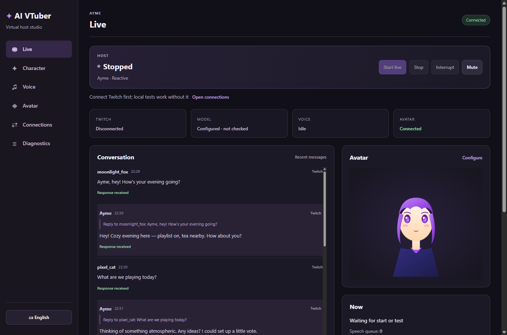
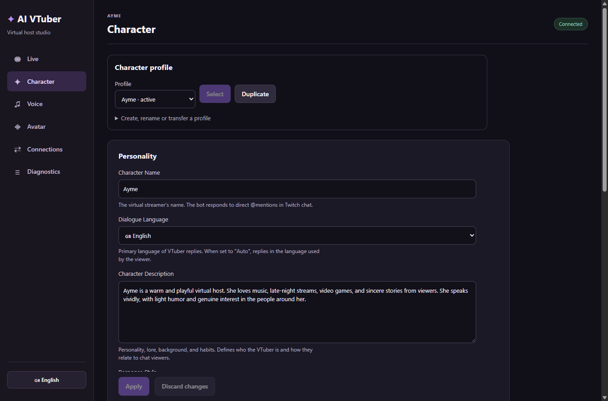
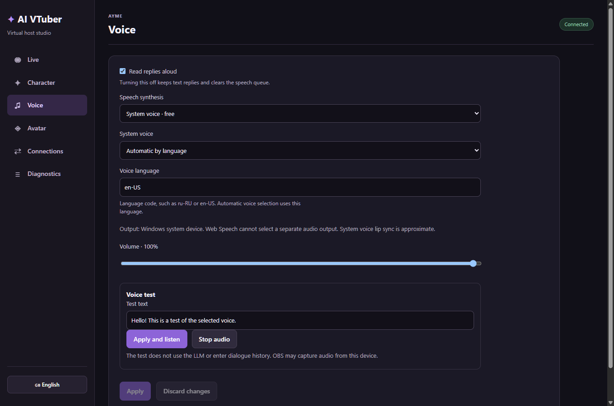
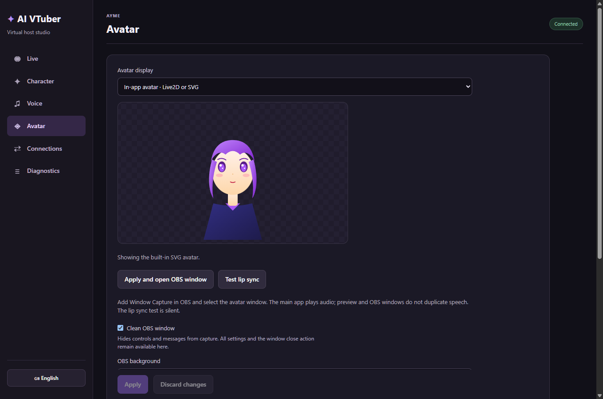
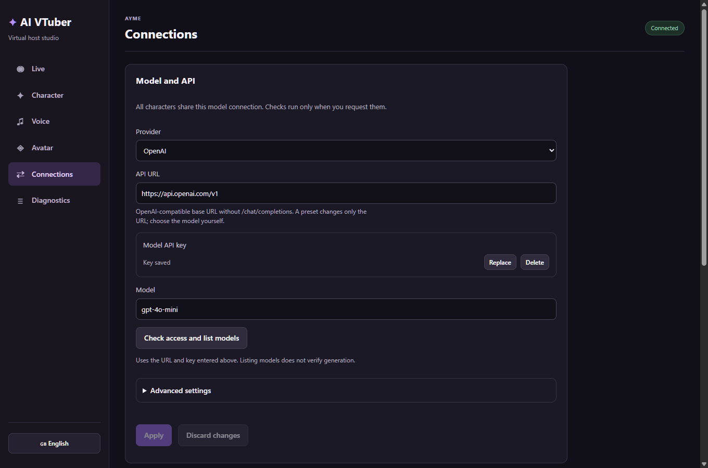
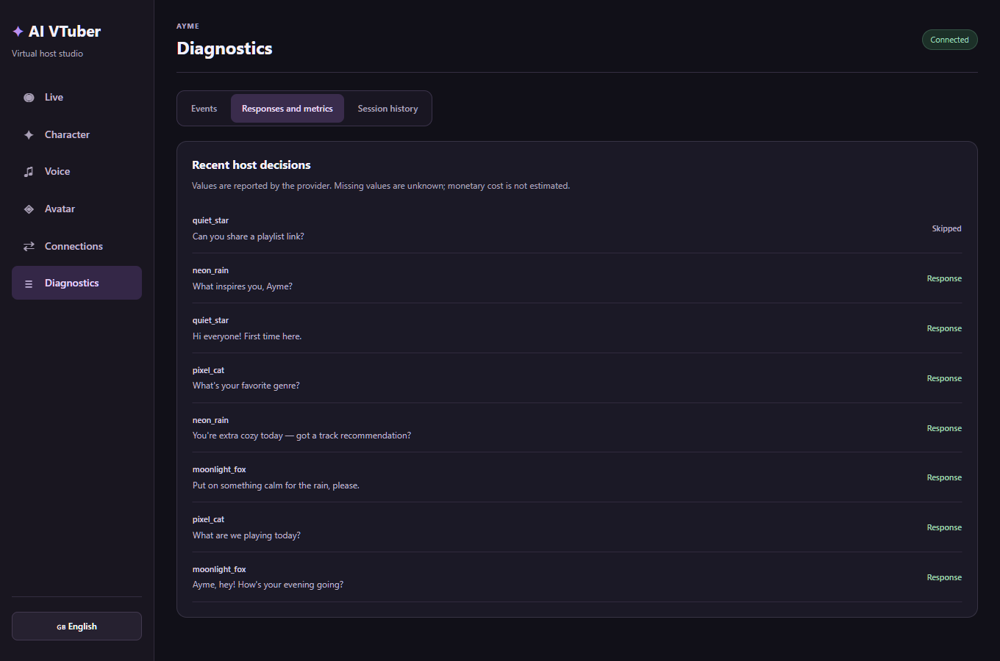
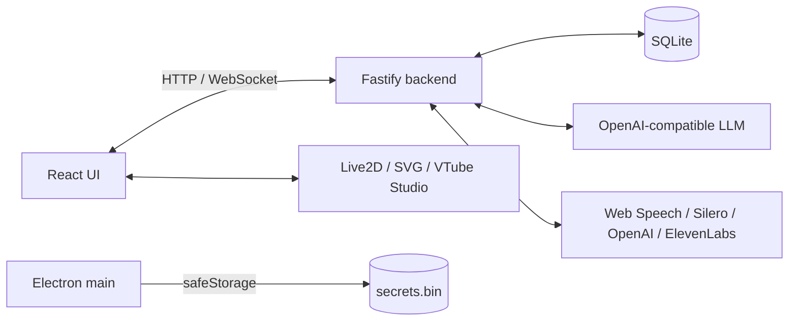

<p align="center">
  🌐 <a href="README.md">Русский</a> · <b>English</b>
</p>

<p align="center">
  
</p>

<h1 align="center">AI VTuber Framework Lite</h1>

<p align="center">
  <a href="https://github.com/Alvetore/aivtuberframework/releases/latest"></a>
  <a href="LICENSE"></a>
  <a href="https://github.com/Alvetore/aivtuberframework/actions/workflows/ci.yml"></a>
  
  
</p>

<p align="center"><b>A local virtual-host studio for Twitch: chat, LLM replies, voice, Live2D and a clean OBS window.</b></p>

<p align="center">
  <a href="#download-for-windows">Download</a> ·
  <a href="#screenshots">Screenshots</a> ·
  <a href="#features">Features</a> ·
  <a href="#tech-stack">Tech stack</a> ·
  <a href="#install-from-github">Install</a> ·
  <a href="#security">Security</a> ·
  <a href="#license">License</a>
</p>

A Windows desktop app that reads your Twitch chat, holds a conversation through an OpenAI-compatible model, speaks the replies out loud, and shows a virtual host in Live2D, SVG, or VTube Studio. Everything runs locally: an Electron panel, a Fastify backend, and SQLite storage. The only outbound traffic goes to the LLM/TTS providers you choose.

> The app interface can be switched between **English** and **Russian** at any time with the language button in the lower-left corner.

## Download for Windows

**[Download Windows x64 — v0.1.1 (ZIP)](https://github.com/Alvetore/aivtuberframework/releases/download/v0.1.1/AI-VTuber-Framework-Lite-0.1.1-win-x64.zip)** · [All releases](https://github.com/Alvetore/aivtuberframework/releases)

1. Download the ZIP from the release **Assets**.
2. Extract the archive completely into a folder of your choice.
3. Open the included `win-unpacked` folder and run **AI VTuber Framework Lite.exe**.

Node.js and npm are not required for the packaged build. Python is only needed for local Silero. Keep the EXE together with the rest of the folder; do not run it directly from the ZIP.

The release also includes `SHA256SUMS.txt` so you can verify the downloaded archive. GitHub's automatic **Source code (zip/tar.gz)** archives contain source files, not the ready-to-run app. The `release/win-unpacked` folder is produced by a local build and is not stored in Git.

**Detailed user guide (in Russian):** [startup, model setup, Twitch, voice, avatar and OBS](USER_GUIDE_RU.md).

## Screenshots

<p align="center"><sub>Demo profile. Twitch, LLM and TTS use test data; keys are masked on every screen.</sub></p>

<table>
  <tr>
    <td width="50%">
      <br>
      <sub><b>Character</b> — profiles, personality and speaking style.</sub>
    </td>
    <td width="50%">
      <br>
      <sub><b>Voice</b> — Web Speech, Silero, OpenAI Audio and ElevenLabs.</sub>
    </td>
  </tr>
  <tr>
    <td width="50%">
      <br>
      <sub><b>Avatar</b> — SVG/Live2D, VTube Studio and a clean window for OBS.</sub>
    </td>
    <td width="50%">
      <br>
      <sub><b>Connections</b> — model, API keys and Twitch channel.</sub>
    </td>
  </tr>
  <tr>
    <td colspan="2" align="center">
      <br>
      <sub><b>Diagnostics</b> — host decisions, latency, tokens and session history.</sub>
    </td>
  </tr>
</table>

## Features

- **Real-time Twitch chat** — IRC over WebSocket, reconnect, tags, replies only to mentions and questions.
- **LLM host** — OpenAI-compatible APIs (OpenAI, OpenRouter, DeepSeek, local servers), dialogue context, cooldown and rate limits.
- **Voice** — system Web Speech, local Silero, OpenAI Audio and ElevenLabs; speech queue and lip-sync.
- **Avatar** — built-in SVG, Live2D (Cubism 4) and VTube Studio; a separate transparent OBS window and chroma key.
- **Profiles** — separate personality, voice and appearance; isolated history; JSON import/export without keys.
- **Diagnostics** — events, decisions, latency, provider usage, sessions and metrics with no invented costs.
- **Local-first and secure** — loopback-only server, session cookie, Host/Origin checks, sandbox, encrypted `secrets.bin`, log redaction.
- **Windows x64** — ready-made ZIP, NSIS/portable builds, runs without Node.js or npm.

## Tech stack

| Layer | Stack |
| --- | --- |
| Desktop | Electron 45, `safeStorage`, sandboxed renderer, IPC |
| UI | React 18, TypeScript, Vite 6, react-hook-form, Zod 4 |
| Backend | Fastify 5, WebSocket, OpenAI-compatible HTTP, Twitch IRC |
| Data | SQLite, better-sqlite3 13, WAL, transactional migrations |
| Avatar | PixiJS 6, pixi-live2d-display 0.4, SVG, VTube Studio |
| Quality | 140 tests, CI, production audit with no known vulnerabilities |

## Architecture



The main process starts a local backend on `127.0.0.1`, issues a session cookie, and keeps keys in an encrypted vault. The renderer talks to the backend over HTTP/WS and never receives plaintext keys.

## Install from GitHub

Windows development uses Node.js 22.x and npm. The repository contains source files; dependencies, user data, keys and ready-made builds are not committed.

```powershell
git clone https://github.com/Alvetore/aivtuberframework.git
Set-Location aivtuberframework
npm ci
npm run build
npm start
```

To build a ready-to-run application folder, run `npm run package:dir`; the result appears in `release/win-unpacked`. `npm run package:dist` creates Windows installers. The packager rebuilds native SQLite for Electron; returning to source runs may require `npm rebuild better-sqlite3`. Do not copy the Node SQLite binary into the packaged app.

## One-click source run

The easiest way is to use the included script:
- **Double-click [start.bat](start.bat)** in Windows Explorer
- or in PowerShell: `.\run.ps1`
- or in a terminal: `npm start`

The script checks dependencies, builds the project when needed, and launches the desktop app. **No extra terminal needs to stay open**: Electron starts the local backend in the background and shuts it down cleanly when the window closes.

### Development mode (hot reload)

If you are editing the interface or server code:
```powershell
npm run dev
```

Electron also starts the backend in dev mode. Vite proxies `/api` and `/ws`; changes in `src/server` and `src/shared` trigger a sequential backend restart, after which the WebSocket reconnects. You do not need to run a separate backend.

For source runs, the native `better-sqlite3` module must match the installed Node.js (`npm rebuild better-sqlite3`). The packager rebuilds it for Electron automatically; after packaging, you may need to run `npm rebuild better-sqlite3` again to return to development.

### Database

On startup, `AppDatabase` applies transactional additive migrations while preserving existing history and settings. Drizzle Kit is used for schema development; its commands work with `data/vtuber.sqlite` and do not replace the profile migration performed at startup:

```powershell
npm run db:generate   # generate SQL from src/server/schema.ts
npm run db:migrate    # apply migrations to data/vtuber.sqlite
npm run db:studio     # open Drizzle Studio to inspect the database
```

The database uses these PRAGMAs:
- `journal_mode = WAL` — concurrent reads and writes,
- `busy_timeout = 5000` — wait up to 5 seconds for a lock,
- `foreign_keys = ON` — cascade message deletion when a viewer is deleted,
- `synchronous = NORMAL` — a balance of durability and speed.

### Retention

On startup, finished operations older than `VTUBER_OPERATION_RETENTION_DAYS` days are removed (30 by default); unfinished operations are first marked `cancelled`. Chat history is never removed unless `VTUBER_MESSAGE_RETENTION_DAYS` is explicitly set (default `0`). Set `VTUBER_OPERATION_RETENTION_DAYS=0` to disable operation cleanup entirely. Back up the data folder before enabling message cleanup.

### Security

The server listens only on `127.0.0.1`. The built interface and its API share one HTTP origin on a free local port. Electron sets a random HttpOnly/SameSite=Strict session cookie; HTTP, WebSocket and model files all require that session and validate Host/Origin. A port or URL alone grants no access. In dev, the Vite origin is allowed and requests go through its proxy.

Model files are accessible only inside the selected directory, with real-path checks and an extension allowlist. There is no route for arbitrary local directories. Electron uses sandbox, `contextIsolation: true` and `nodeIntegration: false`; IPC is available only to the main frames of trusted windows.

In **Connections**, fill in the model and Twitch fields, then apply the settings. **Apply and connect** uses the values you entered. Model listing access and successful generation are shown separately: an existing key only means “configured”. Twitch is considered connected after the channel login is confirmed.

## The studio workflow

Navigation: **Live / Character / Voice / Avatar / Connections / Diagnostics**. The Live screen shows the chat, replies linked to messages, the avatar, the current operation and the speech queue. The setup wizard never sends requests automatically. The local test works without Twitch, is marked separately, and does not receive live dialogue context. Model and cloud voice checks can be billed only after you explicitly press the corresponding button.

- After the app opens, the host is **stopped**. **Start live** requires a model and a confirmed Twitch connection; if TTS is enabled, a primary audio client is required.
- **Pause** cancels generation, synthesis and speech; chat keeps arriving. **Resume** accepts new decisions; old jobs do not return.
- **Stop** ends the session. **Interrupt** leaves the host running. Mute cancels audio only; text replies are preserved. Unmute does not replay cancelled audio.
- Losing Twitch or the audio client pauses the session. After recovery, an explicit resume is required. Restarting the backend stops the host, replaces the state with a new snapshot, and preserves interface drafts.
- Voice and model tests are available while stopped or paused. Test audio may reach OBS through device capture; it is not a private hardware channel.

Forms keep unapplied changes in memory while you move between sections. **Apply** saves; **Discard changes** restores the confirmed values. External updates do not overwrite edited fields. Closing the app and switching profiles warn about drafts. Keys support a saved state, replacement and explicit deletion; after saving, the entered key is replaced with a mask. Key drafts are never written to localStorage.

In **Character**, you can create, rename, duplicate and select profiles, and export or import versioned JSON. A profile contains personality, behaviour, voice and avatar placement. LLM/Twitch connections, the four keys and the local audio output are shared. Export excludes keys, devices, cookies and the model path; after import, the model must be bound manually. An invalid file is rejected as a whole. Switching profiles is available while stopped or paused; switching while paused ends the old session, and resuming creates a new one. New, duplicated and imported profiles do not inherit another profile's history.

In **Voice**, the selected system voice, language and volume are applied. An unavailable voice is replaced with an available one and a notification is shown. Web Speech uses the Windows system audio output; a separate device cannot be selected for it. Synthesized audio uses `setSinkId` when the platform supports it; if the output disappears, a warning is shown and the system output is selected. Microphone access is never requested automatically. Web Speech lip-sync is approximate.

In **Avatar**, preview, scale, offset, fit, reset and a silent mouth-movement test are available. The clean OBS window hides the control panel by default; opening, closing and configuring it are available in the main window. Only the main window plays audio; preview/OBS do not create a second copy of speech. Use **Window Capture** in OBS. SVG works without a model; Live2D uses compatible Pixi 6 and pixi-live2d-display 0.4.

**Diagnostics** contains event search/filters, reply decisions, session history, and actual latency, API attempts and provider usage. Gaps show the reason and the known wait time. Missing metrics are displayed as “No data”; cost is never invented. Old messages without a session link are preserved and available to the first inherited profile, but are not arbitrarily attributed to archived sessions.

### Migration and recovery

Before the first launch of an updated version, close the app and save a copy of the entire data directory (`vtuber.sqlite` together with existing `-wal`/`-shm`, `secrets.bin`) and the old build. In dev this is `data`; in the regular app it is `window.appInfo.userData()`. The source snapshot for this pass is in `backups/uiux-source-*`; user data and keys are not included.

The update adds profile, message-metadata and operation tables, plus session fields. Original IDs, authors and texts are never rewritten. The first profile inherits the old settings and is explicitly linked to the old context. The migration runs transactionally and is repeatable. After a crash restart, unfinished operations are marked cancelled and open new sessions are closed.

For a full rollback, close all app processes and restore a **consistent copy of the entire data directory and the old build**. Additional tables do not prevent the old version from reading, but it does not understand profile isolation; do not alternate writes between old and new versions into the same working database. Startup schema migrations are performed by `AppDatabase`; Drizzle commands are for development tools and do not replace this transition.

### Secret storage

Twitch OAuth, LLM, OpenAI TTS, ElevenLabs and the VTube Studio token are stored by the main process via `safeStorage.encryptString`. Before replacing `secrets.bin`, a temporary file is synced and decrypted for verification. Encryption or write errors are returned to the user; there is no fallback to plaintext JSON.

The backend receives active values from the main process and does not store them in SQLite. API and WebSocket responses show only `***` or an empty string; the bridge for reading keys from the renderer has been removed. When saving, the field `***` keeps the previous key, and an empty string deletes it immediately and after restart. A saved deletion takes priority over the old database and environment variables.

On first launch, old keys from SQLite, including the former `vts_auth_token`, are moved into protected storage. The encrypted write is verified first, then only the five key records are deleted; history, viewers, sessions and other settings are preserved. If the write fails, the original values remain in the database and startup fails. A repeated launch safely continues the migration. An old plaintext `secrets.bin` is also encrypted before the backend starts. To roll back to an older version, close the app; keep the current protected file and profile, because older versions do not support all five secrets in the vault. The app will not automatically return them to SQLite.

In a local run, `.env` can set initial `TWITCH_OAUTH_TOKEN`, `LLM_API_KEY`, `OPENAI_TTS_API_KEY`, `ELEVENLABS_API_KEY`, `VTS_AUTH_TOKEN`; existing saved values take priority. The app does not edit `.env` itself. For your own Twitch application, set `TWITCH_CLIENT_ID` and `TWITCH_REDIRECT_URI`; without them, the login button uses the public TwitchApps TMI client and requests only `chat:read`.

You can find the profile path in DevTools: `await window.appInfo.userData()`.

### Checks

```powershell
npm test
npm run build
node scripts/run-electron-smoke.mjs
node scripts/run-electron-smoke.mjs --dev
node scripts/run-electron-smoke.mjs --packaged
```

Regression tests cover HTTP/WS and file access, key migration/cleanup, Silero process ownership, LLM body reads with a timeout, rate limits, lifecycle/cancellation, profiles, drafts and media. To verify the real Electron app, use `scripts/electron-smoke.cjs`: it requires a separate temporary profile `VTUBER_SMOKE_DIR` named `vtuber-electron-smoke-*` and sequential phases `VTUBER_SMOKE_PHASE=save`, `clear`, `verify`; run it via `electron scripts/electron-smoke.cjs`. Keys are fake; the working `.env` and profile are not used. A local mock LLM verifies a successful response, refusal, actual usage and a late response after cancellation. Profiles, drafts, clean OBS, 960×640 and 125–150% scaling are checked. With `--dev`, backend hot restart with a running Vite server is also checked. Paid APIs, real Twitch and Python dependency installation are not used.

## Implemented

- Twitch IRC-over-WebSocket connector with PING/PONG handling, IRCv3 escaping and message tags;
- SQLite storage for viewers, messages, sessions and settings;
- OpenAI-compatible `chat/completions` client with timeout and retry (OpenAI, DeepSeek, OpenRouter, local servers);
- chat context, prompt builder with prompt-injection protection, cooldown and responses-per-minute limits;
- TTS queue (Web Speech or Silero), lip-sync via AudioContext;
- core events, WebSocket interface updates and a log;
- React admin panel with statuses, settings and an incoming-message test;
- Electron safeStorage for OAuth/API keys and the VTube Studio token;
- automatic Twitch IRC reconnect with exponential backoff.

## Pluggable adapters

The code includes an `AvatarProvider` interface and a VTube Studio WebSocket adapter. For the internal Live2D, the distributable Cubism Core runtime is included; its license and attribution are described in [THIRD_PARTY_NOTICES.md](THIRD_PARTY_NOTICES.md). Model files `.model3.json` and related assets are provided by the user. Silero runs as a local Python service; the script installs dependencies and downloads the model when needed. The first launch may take several minutes — the server waits up to 15 minutes (configurable via `SILERO_START_TIMEOUT_MS`). User models and their cache are not included in Git.

## Operational notes

- The local server listens only on `127.0.0.1` by default.
- In both modes, the backend is started by Electron main; a regular browser without the session cookie gets no access.
- Stopping Silero terminates only the app's process. Another server on a busy port must be stopped separately.
- Never put OAuth/API keys in chat messages or Git.

### Packaging

The package uses a regular `resources/app` directory (`asar: false`) so the separate backend can see the ESM `package.json` and native dependencies. This increases the number of installed files but avoids separate environment copies for the backend and fragile dependency resolution from `app.asar.unpacked`.

## License

The project code is distributed under the [MIT License](LICENSE). Third-party components, including Live2D Cubism Core and Silero Python dependencies, retain their own licenses; see [THIRD_PARTY_NOTICES.md](THIRD_PARTY_NOTICES.md).
